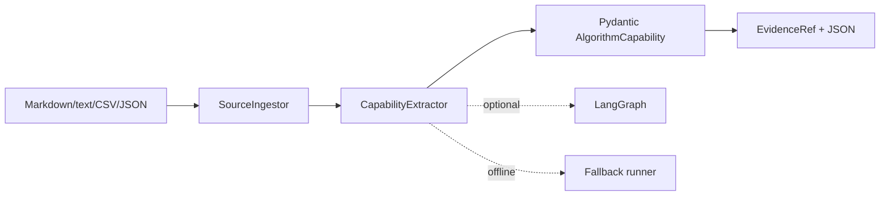
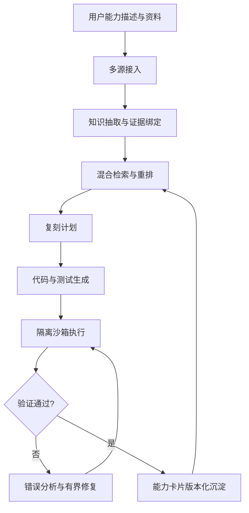

# AlgoWeaver 系统架构

## 当前可运行切片

Source ingestion currently supports UTF-8 text, Markdown, Python, CSV, JSON and YAML. CSV is normalized to Markdown for downstream extraction while the original bytes are hashed for provenance. Unsupported binary formats return an explicit `unsupported` result until their adapter is added.

## Target workflow

The model interprets and proposes; deterministic code validates schemas, routes states, enforces retry limits and records evidence. `verified` is reserved for an independent validation step.
